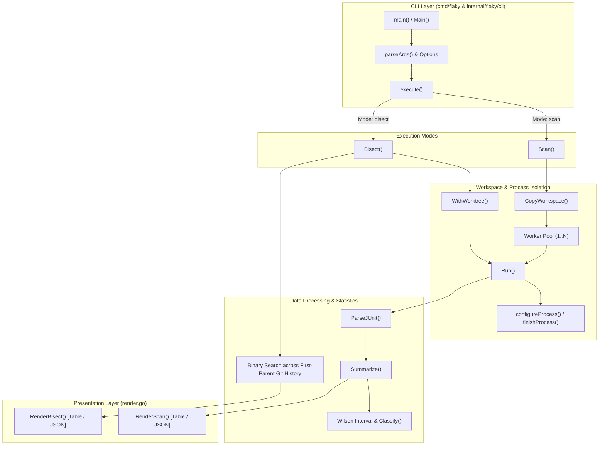

# Architecture of flaky

`flaky` is an offline single-binary CLI tool designed to detect, rank, and bisect intermittent test failures in software repositories using standardized JUnit XML outputs and Wilson score statistical confidence intervals.

---

## High-Level System Architecture

---

## Component Boundaries

### 1. Entry Point & CLI Dispatch (`cmd/flaky`, `internal/flaky/cli.go`, `internal/flaky/execute.go`)
- **`cmd/flaky/main.go`**: Establishes interrupt signal handling using `signal.NotifyContext(context.Background(), os.Interrupt)` and dispatches into `flaky.Main()`.
- **`cli.go`**: Implements custom argument parsing with strict separation before and after the `--` command delimiter. Validates run counts, parallelism constraints, and relative JUnit paths.
- **`execute.go`**: Bridges the validated `Options` structure with `Scan` or `Bisect` workflows and maps internal domain errors to standard exit codes.

### 2. Workspace Isolation (`internal/flaky/workspace.go`)
- Creates ephemeral copies of the source directory using `os.MkdirTemp()`.
- Excludes `.git` and harness-specific temporary files to protect repository state and reduce disk overhead.
- Preserves relative symlinks without dereferencing or copying contents outside the project tree.
- Returns a dedicated cleanup callback (`func()`) guaranteeing filesystem cleanup even during cancellation or error recovery.

### 3. Execution & Process Lifecycle (`internal/flaky/runner.go`, `process_unix.go`, `process_windows.go`)
- **Environment Injection**: Injects `FLAKY_JUNIT_XML` (absolute unique target path) and `FLAKY_RUN_INDEX` (1-based iteration counter).
- **Runner Adapters**: Auto-detects supported runners (`pytest`, `gotestsum`, `jest-junit`, `cargo-nextest`) and adjusts arguments or environment variables accordingly when explicit `--junit` is omitted.
- **Process Group Isolation**:
  - Unix: Configures `Setpgid: true` and sends `SIGKILL` to `-pgid` on process cancellation.
  - Windows: Uses `taskkill /T /F /PID` to terminate the entire process tree.
  - Prevents orphaned child processes from leaking or writing to shared system resources.

### 4. JUnit Parser (`internal/flaky/junit.go`)
- Streams XML using standard library `encoding/xml.Decoder` to parse `<testsuites>`, `<testsuite>`, and `<testcase>` hierarchies.
- Computes canonical test identifiers using fallback precedence: `classname::name` $\to$ `file::name` $\to$ `name`.
- Rejects malformed XML and duplicate test IDs within a single run to ensure data integrity.
- Extracts detailed failure bodies and system-out/err messages for comparative reporting.

### 5. Statistical Modeling & Classification (`internal/flaky/stats.go`)
- **Wilson Score Interval**: Computes 90% confidence intervals for failure rates with continuity correction ($z \approx 1.6448536$):
  $$\tilde{p} = \frac{f + \frac{z^2}{2}}{n + z^2}, \quad w = \frac{z \sqrt{\frac{f(n-f)}{n} + \frac{z^2}{4}}}{n + z^2}$$
  $$\text{Interval} = [\max(0, \tilde{p} - w), \min(1, \tilde{p} + w)]$$
- **Classification**:
  - **Stable**: Upper bound $< 0.10$.
  - **Flaky**: Observed passes $> 0$, failures $> 0$, and lower bound $> 0.10$.
  - **Inconclusive**: Neither condition met (triggers exit code 3 during bisect).
- **Ranking**: Flaky tests are sorted descending by failure rate, followed by consistent failures and stable tests.

### 6. Git Worktree & Bisect Engine (`internal/flaky/git.go`, `internal/flaky/bisect.go`)
- Queries linear history using `git rev-list --first-parent --reverse HEAD`.
- Evaluates individual commits in isolated disposable git worktrees (`git worktree add --detach <path> <hash>`).
- Enforces an immutable anchor contract: oldest commit must classify as **stable**, and `HEAD` must classify as **flaky**.
- Performs binary search across intermediate commits to identify the earliest commit introducing the intermittent failure.
- Cleans all detached worktrees via `git worktree remove --force` upon completion or interruption.

### 7. Presentation & Output Formatting (`internal/flaky/render.go`)
- **Table Mode**: Renders tabular terminal summaries with formatted failure rates, pass/fail counts, missing counts, and diffs between failing and passing runs.
- **JSON Mode**: Outputs strictly typed, machine-readable schemas suitable for programmatic consumption or CI integration.

---

## Technical Constraints & Safety Guarantees

1. **Zero External Go Dependencies**: Implemented strictly with Go standard library (`stdlib`).
2. **Read-Only Repository Safety**: `flaky` never modifies the user's checked-out working branch or `.git` index. All executions happen in detached worktrees or ephemeral scratch directories.
3. **Deterministic Cleanup**: All background processes, temporary worktrees, and workspace copies are registered with deferred cleanup handlers and signal contexts.
